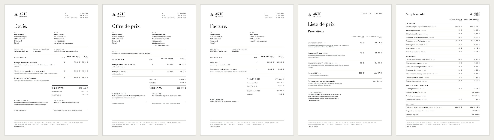

# Devis, offres de prix, factures et listes de prix

Ce dossier contient les quatre documents commerciaux d'Arte Automobili, dans la direction artistique de la grille tarifaire blanche.



| Exemple | Fichier |
|---|---|
| Devis (particulier) | [exemples/d-2026-000-sophie-lambert.pdf](exemples/d-2026-000-sophie-lambert.pdf) |
| Offre de prix (professionnel) | [exemples/op-2026-000-societe-exemple-srl.pdf](exemples/op-2026-000-societe-exemple-srl.pdf) |
| Facture (particulier, réglée sur place) | [exemples/f-2026-0000-marc-lefevre.pdf](exemples/f-2026-0000-marc-lefevre.pdf) |
| Liste de prix (2 pages) | [exemples/liste-de-prix-2026-10-29.pdf](exemples/liste-de-prix-2026-10-29.pdf) |

Les clients des exemples sont fictifs. Leurs numéros se terminent par 000, donc tes vrais documents commencent à 001.

## Me demander un document

Envoie-moi simplement :

1. **Le type** : devis, offre de prix, facture ou liste de prix.
2. **Le client** :
   - pour un particulier : nom, adresse, e-mail ou téléphone ;
   - pour un professionnel : société, personne de contact, adresse et numéro de TVA.
3. **Le véhicule**, facultatif : modèle, plaque, remarque.
4. **Les prestations choisies**, avec les quantités. Pour une prestation « sur devis », précise son prix.
5. **Pour une facture** : la date de la prestation et si le client a déjà payé sur place.

Exemple :

> Facture pour Julie Martin, rue des Prés 3, 7100 La Louvière, julie@mail.be. Golf 7 noire, 1-XYZ-001. Lavage intérieur + extérieur et traitement à l'ozone, fait et payé hier sur place.

Je te renvoie le PDF. Le numéro suivant est attribué automatiquement.

## Devis ou offre de prix ?

- **Devis** :
  - pour un véhicule précis, après l'avoir vu ;
  - prix TVAC pour un particulier ;
  - zone « Bon pour accord » à signer ;
  - valable 30 jours.
- **Offre de prix** :
  - proposition commerciale, en général pour un professionnel ou une flotte ;
  - prix HTVA, puis TVA 21 % et total TVAC ;
  - objet libre (« entretien de six véhicules ») ;
  - valable 30 jours.

Les deux fonctionnent pour les deux types de clients. Seul le mode d'affichage change :

| Client | Affichage | Total qui fait foi |
|---|---|---|
| Particulier | Prix TVAC | Le total TVAC (prix du site), avec la base HTVA et la TVA indiquées en dessous |
| Professionnel | Prix HTVA | Le total HTVA, puis TVA 21 % et total TVAC |

Une remise en pourcentage est possible, par exemple « remise flotte 10 % ».

## Les données enregistrées

Tout est dans un seul fichier : [`_source/documents/donnees.json`](../_source/documents/donnees.json). Ce fichier alimente aussi la grille tarifaire de `17_tarifs`.

**Prestations**, prix TVAC du catalogue (HTVA = TVAC / 1,21) :

| Prestation | Durée | Particuliers TVAC | Professionnels HTVA |
|---|---|---|---|
| Lavage intérieur | 1 h | 45 € | 37,19 € |
| Lavage extérieur | 45 min | 40 € | 33,06 € |
| Lavage intérieur + extérieur | 1 h 45 | 75 € | 61,98 € |
| Pack ARTE | 3 h | 135 € | 111,57 € |
| Services pour les professionnels | — | Sur devis | Sur devis |

**Suppléments** : 22 suppléments, ceux de la section « Suppléments de prestation ».

**Entreprise** :
- adresse : Rue Lait Beurré, 7100 La Louvière ;
- horaires : du lundi au samedi, de 9 h à 18 h ;
- site : arteautomobili.be ;
- signature : « L'arte del riflesso. ».

**Conditions** :
- validité de 30 jours pour les devis et les offres ;
- paiement sur place ;
- échéance de 15 jours pour une facture non réglée ;
- TVA 21 %.

### À compléter ou confirmer

Ces valeurs figurent entre crochets sur les documents tant que tu ne me les as pas données :

- dénomination légale et forme juridique, par exemple « Arte Automobili SRL » ;
- numéro de la rue ;
- numéro d'entreprise ou de TVA (BE 0…) ;
- IBAN et BIC ;
- téléphone et e-mail.

À confirmer aussi :

- **Prix des suppléments.** Ce sont les prix indicatifs que j'ai proposés dans la section. Indique-moi les tiens.
- **Contenu du Pack ARTE.** Il est décrit pour l'instant comme « La formule premium Arte Automobili ».
- **Prix affichés par le thème.** Les réglages de ton thème exporté le 27 octobre affichent 60 €, 60 € et 100 € pour les trois lavages. Ton catalogue affiche 45 €, 40 € et 75 €. Les documents utilisent les prix du catalogue. Vérifie lequel est à jour sur le site.

## Règles belges intégrées

- **Numérotation continue** par année et par type : D-2026-001, OP-2026-001, F-2026-0001. Le compteur est dans [`compteurs.json`](compteurs.json). Si tu as déjà émis des factures cette année avec un autre outil, donne-moi le dernier numéro pour continuer la suite.
- **Mentions de facture** :
  - date d'émission et date de la prestation ;
  - coordonnées et numéro de TVA des deux parties (celui du client s'il est professionnel) ;
  - quantité et prix unitaire ;
  - base HTVA, taux et montant de TVA, total TVAC ;
  - échéance et virement avec une communication structurée (+++…+++) ou mention « acquittée ».
- **Facture à une entreprise assujettie à la TVA.** Depuis le 1er janvier 2026, elle doit en principe être transmise en facture électronique par le réseau Peppol. Le PDF reste utile comme copie lisible, mais pour ces clients il faut un logiciel de facturation connecté à Peppol. Vérifie avec ton comptable. Les factures aux particuliers ne sont pas concernées.
- **Régime de franchise des petites entreprises.** Si tu en relèves (pas de TVA facturée), passe `regime_franchise` à `true` dans `donnees.json`. Les documents n'affichent alors plus de TVA et ajoutent la mention légale.

## Côté technique

```bash
python3 _source/documents/documents.py demande.json   # un document, numéro suivant
python3 _source/documents/documents.py exemples       # régénère les quatre exemples
python3 _source/tarifs/tarifs.py && node _source/tarifs/pdf.mjs   # grille tarifaire 17_tarifs
```

Une demande est un petit fichier JSON. Le format est décrit en tête de [`documents.py`](../_source/documents/documents.py), et des exemples sont dans [`exemples.json`](../_source/documents/exemples.json). Les documents réels sont rangés dans `devis/`, `offres/`, `factures/` et `listes/`, chacun avec sa demande en JSON pour pouvoir le régénérer.

Ces dossiers contiendront les coordonnées de vrais clients. Si ce dépôt GitHub est public, passe-le en privé.
