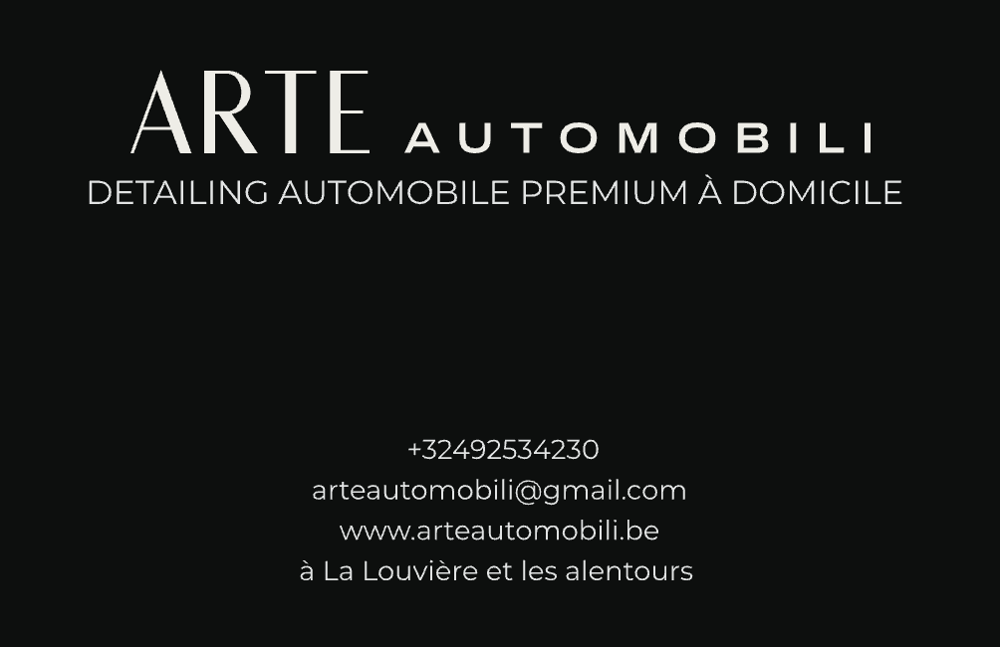
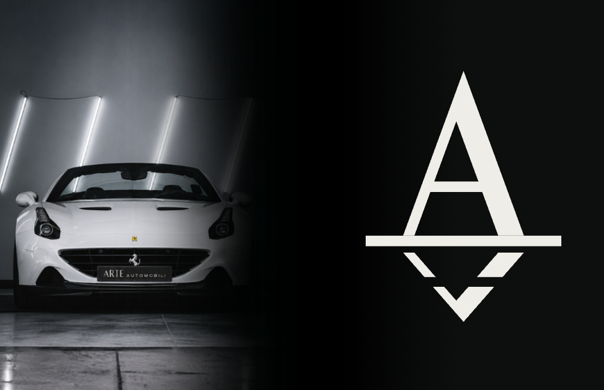

# Carte de visite

Ta carte, refaite au format européen 85 × 55 mm et prête pour l'imprimeur.




| Fichier | Usage |
|---|---|
| `carte-de-visite-arte-automobili-85x55-fonds-perdus-3mm.pdf` | Le fichier à envoyer à l'imprimeur |
| `apercu-face-1.png`, `apercu-face-2.png` | Aperçus au format fini |
| `carte-arte-face-1.svg`, `carte-arte-face-2.svg` | Sources vectorielles |
| `design-original/` | Ton design d'origine (Canva, 3,5 × 2 pouces), conservé tel quel |

## Ce qui a changé par rapport à ton design

Ton design faisait 88,9 × 50,8 mm, le format américain de Canva. Je l'ai recomposé en 85 × 55 mm sans rien changer au contenu :

- **Mêmes éléments, mêmes tailles, mêmes couleurs.** La composition est simplement recentrée sur le nouveau format, un peu plus haut et un peu moins large.
- **Texte et logo en vectoriel.** Ils restent nets à l'impression au lieu d'être une image :
  - « ARTE » et le monogramme viennent des fichiers du logo ;
  - « AUTOMOBILI » est en Archivo, la police de la marque ;
  - le slogan et les coordonnées sont en Montserrat, comme dans Canva.
- **Contrôle.** Le rendu au format d'origine se superpose à ton image au pixel près.
- **Photo de la voiture.** Elle est reprise de ton image et agrandie d'environ 20 % pour remplir la hauteur et les fonds perdus. Elle sort à environ 250 ppp, ce qui reste correct pour une carte.
- **Marges.** Tous les textes sont désormais à au moins 5,5 mm du bord de coupe. Sur l'original, certains étaient à 3,5 mm, trop près pour une impression sûre.

## Pour l'imprimeur

- **Format fini :** 85 × 55 mm.
- **Fichier :** 91 × 61 mm, avec 3 mm de fonds perdus et sans traits de coupe.
- **Pages :** la page 1 est la face avec les coordonnées, la page 2 la face avec la photo et le monogramme.
- **Texte :** entièrement vectorisé, sans police à installer.
- **Couleurs :** en RVB ; l'imprimeur convertit en CMJN.
- **Papier conseillé :** un papier mat de 350 à 400 g/m². Sur fond noir, un pelliculage mat ou soft-touch évite les traces de doigts.

## Proposition blanche

Ma première proposition, en version blanche minimale, est rangée dans `proposition-blanche/`.

## Régénérer

```bash
python3 _source/carte_visite/carte_arte.py            # ta carte, 85 × 55 mm
python3 _source/carte_visite/carte_arte.py controle   # rendu au format d'origine, pour comparaison
python3 _source/carte_visite/carte.py                 # proposition blanche
```

La police Montserrat (licence libre SIL OFL) est incluse dans `_source/carte_visite/polices/`.
