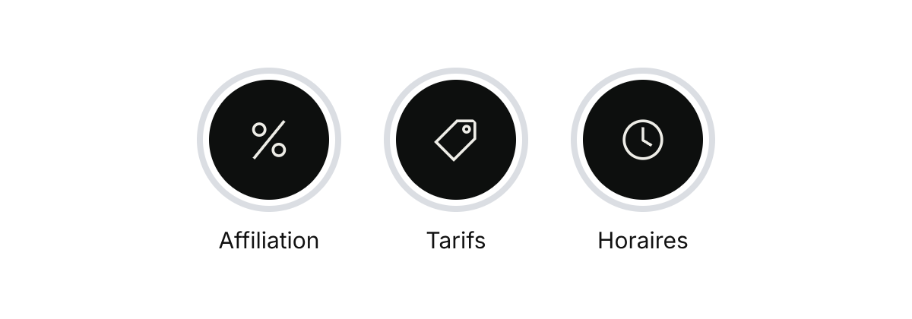

# Couvertures « À la une » d'Instagram



| Fichier | À la une | Icône |
|---|---|---|
| `une-affiliation.png` | Affiliation | Le « % » de la commission partenaire |
| `une-tarifs.png` | Tarifs | Une étiquette de prix |
| `une-horaires.png` | Horaires | L'horloge du jeu d'icônes de la marque |

Le style suit le jeu d'icônes de la marque : trait fin blanc cassé (Bianco), extrémités carrées, angles vifs, sans remplissage, centré sur le fond noir (Nero) des stories. Les images font 1080 × 1920 px : Instagram ne garde que le cercle central, où se trouve l'icône.

## Mettre une couverture

1. Sur ton profil, appuie longuement sur la story à la une, puis sur **Modifier la story à la une**.
2. Appuie sur **Modifier la couverture**, puis sur l'icône de galerie.
3. Choisis l'image, garde-la centrée, puis appuie sur **OK**.

## Régénérer

```bash
python3 _source/reseaux/a_la_une.py
```

Pour ajouter une story à la une (par exemple « Prestations » ou « Avant / Après »), il suffit d'ajouter une ligne dans `ICONES` ; les icônes du jeu de la marque (`05_univers-graphique/icones/`) peuvent servir telles quelles.
