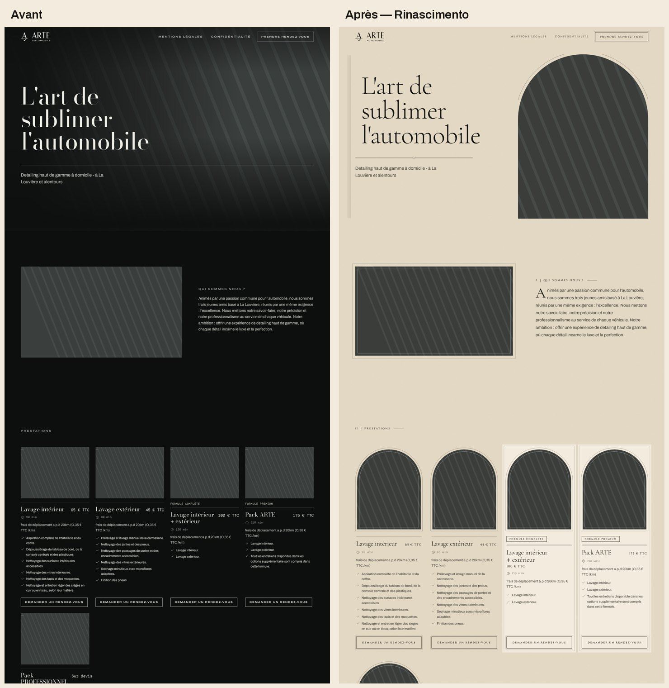

# Refonte « Rinascimento » : Renaissance italienne contemporaine

La refonte graphique complète de ton thème. Elle part de ton export du 9 novembre 2026 (« Copie de Arte Automobili theme premium »). Le design change entièrement, alors que les informations et les fonctionnalités restent strictement identiques.

| Fichier | Contenu |
|---|---|
| `arte-automobili-rinascimento.zip` | Le thème refait, à importer dans Shopify |
| `theme/` | Les mêmes fichiers, décompressés |
| `sauvegarde/` | Ton export d'origine, intact (SHA-256 `58bcc55f…1c3`) |
| `apercus/` | Avant / après de l'accueil et des services, toutes les pages, version mobile |
| `verification.txt` | Le rapport de comparaison entre l'original et la refonte |
| `licences/` | Licences libres (SIL OFL) des deux nouvelles polices |

Dans les aperçus, les photos sont remplacées par des motifs rayés. Ils sont rendus sur mon ordinateur de test, qui n'a pas accès aux images de ta boutique. Sur ton site, ce seront tes photos.

## La direction artistique

- **Palette :** uniquement du beige et du noir.
  - Le fond dominant est le parchemin (#E8DDC8). L'ivoire (#F3EBDD) et le beige foncé (#C9B99E) servent aux surfaces et aux filets.
  - L'encre (#171512) et l'encre secondaire (#24211D) servent aux textes et aux sections de contraste.
  - Les anciennes sections vertes (horaires, bandeaux « Parlons de votre véhicule », « Rejoignez le club ») deviennent des sections noires. Le pied de page est noir.
- **Typographies :**
  - **Cormorant Garamond** pour les titres, un Garamond de la Renaissance, avec des italiques élégantes.
  - **Cinzel** pour les intitulés, menus, boutons et prix. Ce sont les capitales des inscriptions romaines gravées.
  - **Archivo**, la police de ta marque, reste pour le texte courant : elle apporte le contraste moderne.
  - Les polices sont hébergées dans le thème, sans appel externe.
- **L'arc florentin :**
  - la grande photo de l'accueil est une fenêtre cintrée, soulignée d'un double filet ;
  - les prestations et les options forment une **loggia**, une arcade de fenêtres en plein cintre, comme à l'hôpital des Innocents de Brunelleschi ;
  - les photos de la page Services ont un arc surbaissé.
- **Le cadre de tableau :** les photos rectangulaires ont un passe-partout et un filet intérieur, comme une toile encadrée.
- **Les détails gravés :**
  - les sections sont numérotées en chiffres romains (I, II, III, IV) ;
  - les séparateurs sont une corniche : double filet avec un losange au centre ;
  - le texte « Qui sommes nous ? » commence par une lettrine de manuscrit ;
  - un pilastre cannelé discret borde le titre d'accueil ;
  - un grain d'enduit de fresque, très léger, donne de la matière au fond.
- **Les formules mises en avant** (Formule complète, Pack ARTE) sont posées sur un panneau d'ivoire encadré. Les mentions apparaissent sous forme de petites plaques gravées.
- **Les animations :**
  - à l'arrivée, le titre s'élève, la corniche se trace et l'arche se dévoile de bas en haut ;
  - au défilement, les blocs apparaissent lentement et les photos se posent ;
  - au survol, les boutons à double filet s'inversent et les liens se soulignent depuis le centre.
  - Tout se coupe si le visiteur a demandé de réduire les animations.
- **Les photos** reçoivent une légère patine commune, pour dialoguer avec le parchemin. Elles ne sont ni remplacées ni recadrées.
- **La page de lancement** devient une scène sombre, voile d'encre et textes de parchemin. La page mot de passe est une feuille de parchemin.

## Ce qui n'a pas changé

La vérification automatique (`verification.txt`) compare l'original et la refonte page par page. Elle couvre l'accueil, les services, la présentation, le contact, la confirmation d'envoi, l'histoire, la fidélité, l'espace client, une page simple, le lancement, le mot de passe, la page 404, la recherche et le panier.

- **Textes et prix :** les 1 123 textes affichés sont identiques au caractère près, y compris les prix, les durées et les coordonnées. Les fautes d'orthographe d'origine ont été laissées telles quelles, comme demandé.
- **Liens et médias :** les 357 liens, les textes alternatifs des images et les 50 champs de formulaire sont identiques.
- **Fichiers de contenu :** seuls 9 réglages de couleur diffèrent, et ce sont des couleurs, jamais du contenu.
  - Les 5 couleurs du thème passent au beige et au noir.
  - L'en-tête passe en beige avec un texte noir.
  - Le pied de page passe à la palette noire.
  - Le dégradé de la page mot de passe, qui contenait du vert sans être affiché, passe au noir.
- **Fonctionnalités :** testées sur l'original et la refonte, avec le même résultat.
  - Le menu mobile s'ouvre et se ferme, et l'en-tête se fixe au défilement.
  - La carte Google ne se charge qu'après accord du visiteur.
  - Le formulaire de contact affiche les 5 mêmes messages d'erreur.
  - Les questions fréquentes s'ouvrent.
  - L'espace client garde sa navigation, sa carte de fidélité et son QR code.
  - Aucune erreur JavaScript.
- **Couleurs :** l'analyse des couleurs réellement affichées ne trouve que du beige et du noir. Il ne reste aucune trace du vert dans le code.
- **Validateurs :** Theme Check Shopify, les schémas officiels Shopify et le Liquid en mode strict n'affichent aucune erreur.

## Ce qui a été modifié dans le code

Tout est additif ou limité à l'apparence :

- **Nouveaux fichiers :** `assets/renaissance.css` (la couche graphique, chargée en dernier), les polices `CormorantGaramond.woff2`, `CormorantGaramond-Italic.woff2` et `Cinzel.woff2`, et `monogramme-nero.svg` (le monogramme à l'encre noire).
- **Couleurs :**
  - `snippets/palette.liquid` réécrit les palettes en beige et noir. Les noms d'origine sont conservés pour tes réglages déjà enregistrés.
  - `snippets/css-variables.liquid` change le fond général et les polices.
  - Les couleurs codées en dur des feuilles de style, du QR code et des valeurs par défaut sont converties.
  - Les logos et le favicon gardent les mêmes tracés, aux nouvelles couleurs.
- **Mises en page :** `layout/theme.liquid` et `layout/password.liquid` chargent les nouvelles polices et la nouvelle feuille de style.
- **Logo noir :** `sections/main-password.liquid` affiche le logo noir sur le parchemin. L'inversion de couleurs, qui aurait produit du bleu, est remplacée par un vrai fichier noir.
- **Éditeur du thème :** les noms des couleurs et des palettes sont mis à jour. Par exemple, « Verde (vert de marque) » devient « Noir de contraste (sombre) ».

## Installer sans risque

Ton site en ligne n'est pas touché tant que tu ne publies pas.

1. Dans Shopify : **Boutique en ligne › Thèmes › Ajouter un thème › Importer un fichier ZIP**, puis choisis `arte-automobili-rinascimento.zip`.
2. Le thème arrive dans la **bibliothèque**, non publié. Clique sur **Aperçu** pour le parcourir avec tes vraies photos, sur ordinateur et sur téléphone.
3. Si tout te plaît, clique sur **Publier**. Pour revenir en arrière, il suffit de republier ton ancien thème : il reste dans la bibliothèque.

Si tu as modifié des textes ou des prix sur ton site depuis le 9 novembre, ces changements ne sont pas dans ce ZIP, puisqu'il part de ton export. Envoie-moi un nouvel export et je réapplique la refonte dessus.

## Régénérer les vérifications

Les scripts de rendu et de comparaison sont dans mon espace de travail (`preview3.mjs`, `rn-shoot.mjs`, `verifier.py`, `rn-fonctions.mjs`). Le rapport final est copié dans `verification.txt`.
